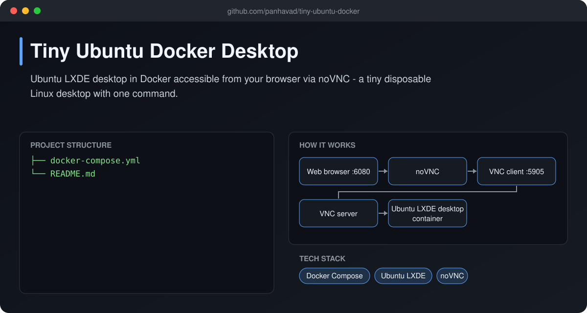
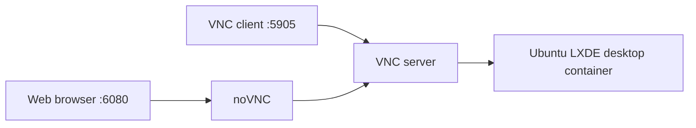

# Tiny Ubuntu Docker Desktop

 [](https://github.com/panhavad/tiny-ubuntu-docker/releases/latest)

Spin up a **disposable Ubuntu LXDE desktop in Docker** and use it straight from your **web browser** via noVNC (or any VNC client).



## Features

- Browser access on port 6080
- VNC access on port 5905
- Shared memory mount for smooth browsers
- One `docker compose up`

## How it works



## Getting started

```bash
docker compose up -d
# open http://localhost:6080  (user: admin / pass: admin - change it!)
```

## Download

Grab the packaged source from the [latest release](https://github.com/panhavad/tiny-ubuntu-docker/releases/latest).

## Tech stack

- Docker Compose
- Ubuntu LXDE
- noVNC

## Project structure

```text
tiny-ubuntu-docker/
├── docs/
├── docker-compose.yml
└── README.md
```

## Original notes

Bringup: `docker compose up`

Access the web: `localhost:6080`

Username: `admin`

Password: `admin`
